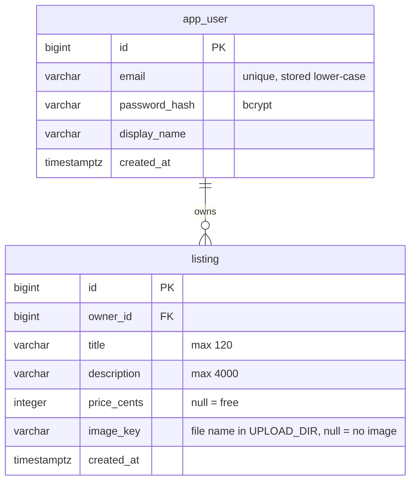

# Data model

Postgres 16. The schema is owned by **Flyway**: `backend/src/main/resources/db/migration/V<n>__<what>.sql`. Hibernate only validates it (`ddl-auto: validate`), so a new column needs a migration *and* the field in the entity.

Rules:

- Never edit a migration that has run somewhere (staging counts). Add the next number instead.
- Keep the SQL portable: tests run on H2 in PostgreSQL mode (`application-test.yml`).
- Update this file in the same pull request.

## Tables

| Table | Entity | Notes |
|---|---|---|
| `app_user` | `user/User.java` | `user` is a reserved word in Postgres, hence the prefix. Passwords: bcrypt, never returned by the API |
| `listing` | `listing/Listing.java` | Images are files, not database rows: `image_key` is `<uuid>.<jpg\|png\|webp>` in `UPLOAD_DIR` (a Docker volume on the hosts), served by `GET /api/listings/{id}/image` |

## Seed data

`web/DemoData.java` fills an **empty** database (no users yet) with `demo@example.com` and four listings when `APP_SEED_DEMO=true`: locally (password `demo12345`) and on staging (password = secret `STAGING_APP_SEED_DEMO_PASSWORD`). Prod runs with `APP_SEED_DEMO=false`.

## Backups

On the app hosts the database container carries the label `backup.dump: postgres`: a `pg_dumpall` every night at 01:30 into `/srv/apps/hackaton/dumps/` (7 kept), then the whole VM goes to PBS. Uploaded images are in the `uploads` volume, which is part of the VM backup.
